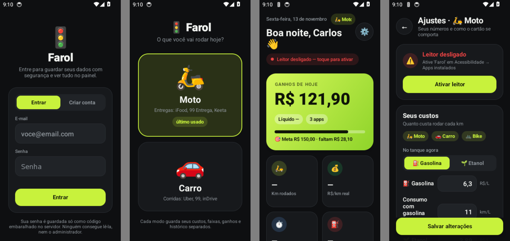
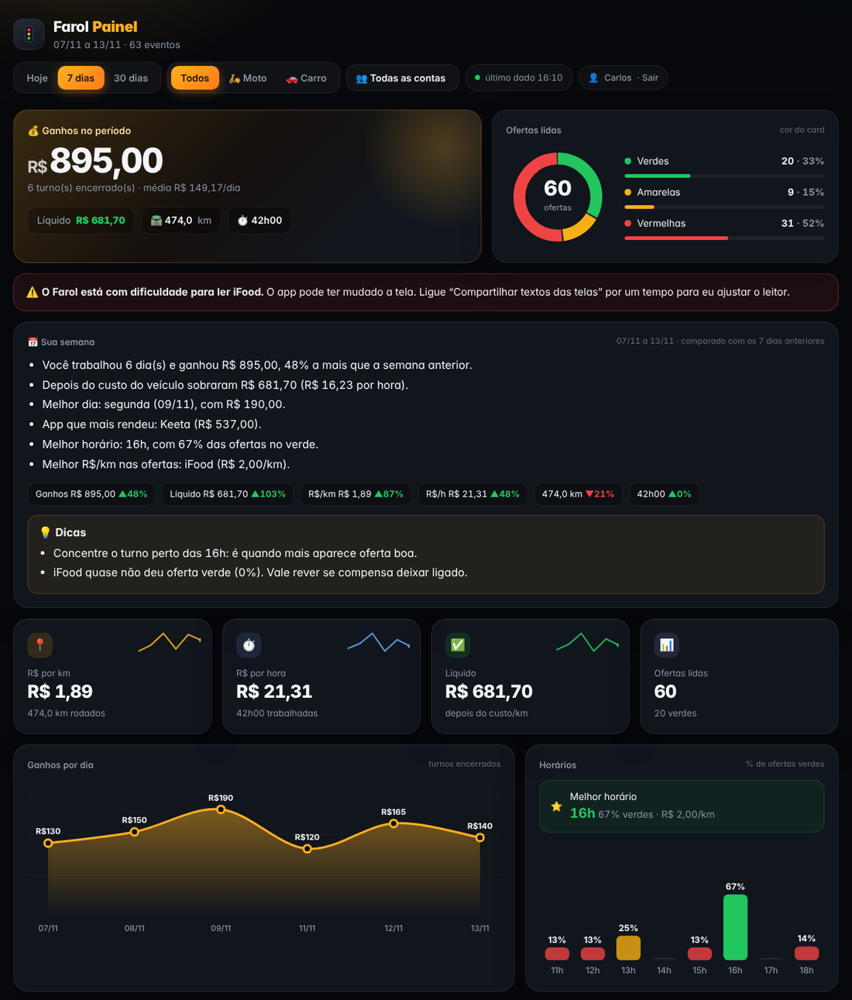
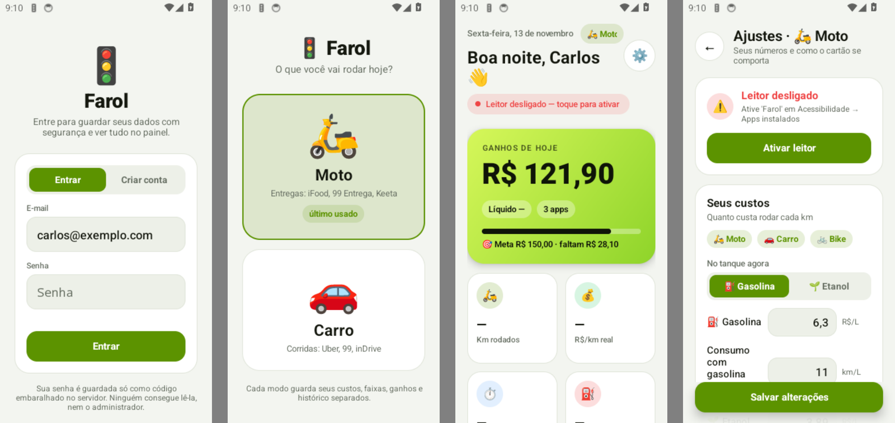
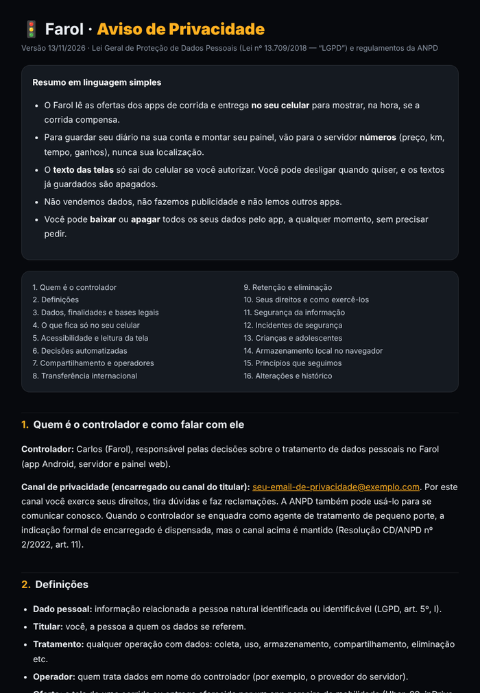
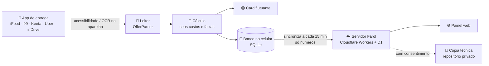

<div align="center">

# 🚦 Farol

### O copiloto do entregador e do motorista de app

Lê a oferta do **iFood, 99, Keeta, Uber e inDrive** e mostra na hora se a corrida compensa,<br>
com **R$/km, R$/h e lucro líquido** calculados com os **seus** custos.




**[⬇️ Baixar o app](https://github.com/carlospjjj-oss/farol-app/releases/latest)** · [Como instalar](#-instalar) · [Painel web](#-painel-web) · [Privacidade](#-privacidade-e-lgpd) · [Histórico](#-histórico)

</div>

---

## ✨ O que o Farol faz

<table>
<tr>
<td width="33%" valign="top">

### 🟢 Avalia a oferta
Quando a oferta aparece, um **card flutuante** mostra se ela é **boa, média ou ruim** (verde, amarelo ou vermelho), com R$/km, R$/h, km, tempo, busca, nota do passageiro e o **lucro depois do custo** do seu veículo.

</td>
<td width="33%" valign="top">

### 📒 Organiza seu dia
**Turno** com km do painel, pausas e GPS; **ganhos por app** lidos sozinhos; **abastecimentos** com gasolina ou etanol; **meta do dia**; tempo por pedido e **melhores horários**.

</td>
<td width="33%" valign="top">

### 📊 Mostra o que rende
**Painel web** com ganhos ao vivo, resumo da semana, melhores horários, R$/km por app e um **alerta quando um app muda a tela** e o leitor perde leituras.

</td>
</tr>
</table>

> O Farol **só lê** a tela. Ele **nunca** toca em aceitar ou recusar e não interfere nos apps. A decisão é sempre sua.

---

## 🎯 O card das ofertas

```
┌──┬────────────────────────────────┐
│✓ │ R$ 6,56  ★ 4,97          IFOOD │   faixa e borda na cor do veredito
│  │ Tempo    Km       Busca        │   ✓ verde   ! amarelo   ✕ vermelho
│  │ 9 min    2,1 km   0,4 km       │
│  │ R$/km    R$/h     Lucro        │   R$/km e R$/h coloridos separadamente
│  │ 2,48     34,70    5,21 (79%)   │
└──┴────────────────────────────────┘   toque = fecha · arraste = move
```

- **Suas faixas:** você define o que é verde e amarelo em R$/km, R$/h e nota do passageiro. Também dá para definir condições mínimas (preço, lucro, % de lucro) e limites de tempo, distância e busca.
- **Avisos que forçam o vermelho:** busca longa, nota baixa, área de risco, palavras de alerta e bairros a evitar. **Bairros favoritos** ficam destacados.
- **Tamanho:** P, M ou G, além de um modo compacto. Pode **falar** o valor e **vibrar** no verde.
- **Velocidade aprendida por app:** quando a tela não mostra o tempo, o Farol estima o R$/h pela sua velocidade real naquele app.

---

## 📱 Apps suportados

| App | Modo | Lê a oferta | Ganhos automáticos | Tempo por pedido |
|---|---|:---:|:---:|:---:|
| **Keeta** | 🛵 Moto | ✅ texto direto | ✅ | ✅ |
| **iFood** | 🛵 Moto | ✅ texto direto | ✅ | ⏳ |
| **99 / 99 Entrega** | 🛵 🚗 | ✅ por OCR (~1 s) | ✅ moto · ⏳ carro | ⏳ |
| **Uber** | 🚗 Carro | ✅ | — | — |
| **inDrive** | 🚗 Carro | ✅ (tela do motorista) | — | — |

**🛵 Moto e 🚗 Carro são dois modos separados**, cada um com os seus custos, faixas, apps, turnos e histórico. Você escolhe na abertura.

O leitor ignora os valores que não são o preço da corrida: dinâmica `+R$ 3`, "inclui R$ 3 de bônus", "Promo R$ 5", "R$ 1,80/km", "R$ 1,02 tarifa base incluída", ganhos do dia e a seta de navegação do mapa.

---

## 💰 Financeiro e diário

| | |
|---|---|
| ⏱️ **Turno** | Início e fim com km do painel, **pausar e retomar** (a pausa não conta nas horas), editar e excluir |
| 📍 **GPS (opcional)** | Sugere os km rodados e mede a velocidade real; nada muda sem você tocar em "Usar" |
| 💵 **Ganhos por app** | Lidos sozinhos do painel dos apps ou digitados; por dia, semana e mês |
| ⛽ **Combustível** | **Gasolina e etanol** com preço e consumo de cada um, comparação de qual compensa e consumo real medido de tanque cheio a tanque cheio |
| 🧮 **Custos do mês** | Calculadora com manutenção, depreciação, IPVA, licenciamento e seguro, que vira o seu custo por km |
| 🎯 **Meta do dia** | Barra de progresso no painel, no card, na notificação e no widget |
| 📈 **Resultados** | Lucro líquido, R$/hora, R$/km, melhores horários e restaurantes mais demorados |
| 🗂️ **Histórico** | Todas as ofertas, com filtros e exportação em CSV |

---

## 🌐 Painel web

<div align="center"><br><sub>Prévia com dados de exemplo</sub></div>

- **Ganhos ao vivo:** aparecem durante o turno, sincronizados com a conta.
- **📅 Sua semana:** os últimos 7 dias comparados com os 7 anteriores, mais melhor dia, melhor horário, app que mais rendeu e **dicas**.
- **🩺 Saúde do leitor:** a % de ofertas lidas por app. Se um app muda a tela e a leitura cai, aparece um **alerta**.
- **Gráficos:** ofertas por cor, horários, R$/km e R$/h por app e últimas ofertas.
- **Filtros:** Hoje, 7 ou 30 dias, e Moto ou Carro.
- **Contas:** cada pessoa vê só os próprios dados. O administrador vê todas, redefine senhas e acompanha os **erros do app**.

---

## 🎨 Temas



**🌙 Escuro** (grafite + verde-limão), **☀️ Claro** (branco + verde-oliva) ou **📱 Automático**, que segue o celular. Para trocar: *Ajustes → Aparência*.
O card das ofertas fica **sempre escuro**, para aparecer bem sobre qualquer app.

---

## 🔐 Segurança

- **Conta com e-mail e senha.** A senha fica no servidor só como código irreversível (PBKDF2), e a conta é bloqueada por 15 min depois de 8 erros.
- **Sessão no cofre do Android** (Keystore), fora do backup.
- **App assinado com chave protegida**, guardada só nos Secrets do GitHub. A chave foi trocada por rotação (APK Signature Scheme v3): a chave antiga não consegue mais substituir o app.
- **O atualizador confere** o SHA-256 do arquivo, o pacote, a versão e o **certificado** antes de instalar.
- **Acessibilidade limitada** aos apps de corrida e entrega. WhatsApp, bancos e outros apps **não chegam** ao Farol.
- **APK de produção**, sem modo de depuração.

---

## 🛡️ Privacidade e LGPD



- **[Aviso de Privacidade](https://farol-logs.carlos-pjjj.workers.dev/privacidade)** completo, com base legal por finalidade, operadores, retenção e direitos.
- **Aceite** no cadastro e sempre que o aviso mudar.
- **Textos das telas são opcionais** e vêm desligados. Sem esse consentimento, o texto **nem sai do celular**: vão só números.
- **Localização (GPS) e imagens do OCR** ficam **só no celular**.
- **Retenção automática:** o texto é apagado após 90 dias, os relatórios de erro após 180 dias e as tentativas de login após 24 h.
- **No app:** *Ajustes → Privacidade* para **baixar meus dados** e **excluir minha conta** (apaga tudo do servidor na hora).
- **Documentos internos em [`docs/lgpd/`](docs/lgpd):** registro das operações (art. 37), relatório de impacto (RIPD), plano de resposta a incidentes e atendimento aos titulares.

<br clear="right">

---

## 📲 Instalar

1. **Baixe** o `Farol.apk` em **[Releases](https://github.com/carlospjjj-oss/farol-app/releases/latest)**.
2. **Play Protect:** no Brasil, o Google bloqueia apps baixados que usam acessibilidade.
   - Abra *Play Store → foto do perfil → Play Protect → ⚙️* e desligue *"Verificar apps"*.
   - Instale o app e **ligue de novo**.
3. **Configurações restritas (Android 13+):**
   - Tente ligar o Farol em Acessibilidade uma vez.
   - Depois vá em *Configurações → Apps → Farol → ⋮ → Permitir configurações restritas*.
4. **Acessibilidade:** *Acessibilidade → Apps instalados → Farol* → ligar.
5. **Bateria:** *Apps → Farol → Bateria → Sem restrições*. Nos Samsung, tire o Farol também de *Apps em suspensão*.
6. **Abra o Farol**, crie sua conta, aceite o aviso de privacidade e escolha 🛵 ou 🚗.

> **Depois disso, as atualizações chegam sozinhas.** O Farol procura versão nova a cada 6 horas, confere a assinatura e instala. Para buscar na hora: *Ajustes → Atualizações*.

**Primeiro ajuste**, em *Ajustes ⚙️*:
- **Combustível:** preço e consumo da gasolina e do etanol, e qual está no tanque.
- **Outros custos por km:** pela 🧮 calculadora do mês.
- **Suas faixas:** o que é verde e amarelo em R$/km e R$/h.
- **Meta do dia.**

---

## 🏗️ Como funciona por dentro



| Camada | O que usa |
|---|---|
| **App** | Kotlin puro, sem bibliotecas pesadas. Android 8+, telas montadas em código, ML Kit (OCR no aparelho), SQLite, JobScheduler |
| **Servidor** | Cloudflare Workers + banco D1, publicados **automaticamente** pelo GitHub Actions ([`server/`](server)) |
| **Entrega** | GitHub Actions: testes → APK de produção → assinatura com rotação → Release com SHA-256 → atualização automática |
| **Qualidade** | 104 testes unitários, **102 ofertas reais anonimizadas** como teste de regressão e 12 testes no **emulador Android** com prints das telas |

<details>
<summary><b>📁 Estrutura do código</b></summary>

```
app/src/main/java/com/farol/app/
  core/      Leitor (OfferParser), cálculo (ProfitCalculator), catálogo de apps, saúde do leitor,
             ganhos, diário, insights, custos, recusas, mascaramento — Kotlin puro e testável
  data/      Banco (FarolDb), diário (JournalStore), histórico, conta e cofre (Account),
             sincronização (SyncClient), logs, saúde, ajustes, backup, GPS
  service/   Leitor de acessibilidade, OCR, GPS, notificação, tarefas de fundo (FarolJobs), atualizador
  ui/        Login, privacidade, modo, painel (cartões, turno, diálogos), ajustes (por seção),
             histórico, custos, guia, card flutuante, widget, kit visual e temas
app/src/test/         104 testes + ofertas reais em resources/golden/
app/src/androidTest/  testes no emulador (banco, migração, sync, cofre, telas e prints)
server/               worker.js (API, contas, sync, LGPD, painel e aviso) + README
docs/lgpd/            registro das operações, RIPD, incidentes, atendimento
```

</details>

---

## 🗺️ Próximos passos

- [x] Fase 0: segurança (chave nova, atualizador verificado, acessibilidade limitada)
- [x] Fase 1: estrutura (banco, contas, sincronização, tarefas de fundo, testes reais)
- [x] LGPD completa
- [x] Fase 2, parte 1: saúde do leitor e resumo da semana
- [ ] **Explicação no card:** por que a corrida é boa ou ruim, em uma frase
- [ ] Gastos do dia (alimentação, manutenção) e metas da semana e do mês
- [ ] Região de destino e chance de volta, calculadas no próprio celular
- [ ] Faixas calibradas sozinhas e previsão de ganhos por horário
- [ ] Viagens da 99 do carro e ganhos automáticos da 99 do carro

---

## 📝 Histórico

<details>
<summary><b>Ver todas as versões</b></summary>

| Versão | Principais mudanças |
|---|---|
| 6.5.1 | iFood › Financeiro › Lançamentos: cada lançamento com a data do cabeçalho, sem contar duas vezes |
| 6.5 | Lê o histórico de ganhos: Keeta › Estatísticas › Diárias (total de qualquer dia) e 99 › Saldo (cada entrega e bônus, no turno em que aconteceu), sem contar duas vezes; telas de histórico do iFood registradas para montar o leitor |
| 6.4.1 | Corrigir o último dia pelo painel (turno e ganhos); fim do turno depois da meia-noite aceito na edição |
| 6.4 | Card explica por que a oferta é boa ou ruim (frase + motivos); tempo de espera do restaurante (Keeta) no card e no R$/h; ganho automático por entrega concluída (Keeta e 99, sem repetir pedido); gastos do dia e metas de semana/mês com folgas; nome do cliente mascarado e chat nunca enviado |
| 6.3.2 | Turno que passa da meia-noite continua no dia em que começou: o painel não zera e dá para encerrar; ganhos, km e horas contam para esse dia |
| 6.3.1 | Pausa sempre visível: notificação fixa com Retomar, lembrete se um app de corrida abrir pausado, turno novo retoma sozinho, painel mostra "Farol pausado" |
| 6.3 | Visual novo: grafite + verde-limão no app, no ícone, no widget e no painel web; tema claro (branco + verde-oliva) e automático, escolhidos em Ajustes → Aparência; card das ofertas sempre escuro |
| 6.2 | Fase 2 (parte 1): saúde do leitor (ofertas lidas × telas não lidas por app/dia, só números; painel alerta quando a leitura cai) e resumo da semana no painel (comparação com a semana anterior, melhor dia/horário/app e dicas) |
| 6.1 | LGPD: Aviso de Privacidade (servidor `/privacidade`), aceite no cadastro e para contas existentes, compartilhar textos das telas opcional (desligado por padrão; sem ele o texto não sai do celular), Ajustes → Privacidade com baixar meus dados e excluir conta; documentos em `docs/lgpd/` (registro das operações, RIPD, plano de incidentes, atendimento) |
| 6.0 | Fase 1 (estrutura): relatório de travamentos no painel; catálogo único de apps; banco SQLite no lugar dos arquivos (sem limite de 5.000 ofertas, migração automática); turnos e abastecimentos sincronizados com a conta (celular novo recebe tudo; painel com ganhos ao vivo); tarefas de fundo pelo JobScheduler; telas separadas por assunto; testes com 102 ofertas reais anonimizadas + 7 testes no emulador Android |
| 5.4 | Segurança: modos GitHub/Webhook removidos (tokens antigos apagados do celular; logs só pelo servidor com login); acessibilidade só recebe eventos dos apps de corrida/entrega, com modo "descobrir app novo" de 2 min |
| 5.3 | Atualizador confere SHA-256 do arquivo, pacote, versão e certificado da chave antes de instalar. 99 do carro: km pelos pares "N min (X km)", sem somar a seta de navegação do mapa |
| 5.2 | Segurança: chave de assinatura nova (rotação v3, a antiga não substitui mais o app no Android 9+), APK de produção, nenhuma chave no repositório, SHA-256 na publicação |
| 5.1 | Gasolina e etanol guardados em cada modo (preço e consumo de cada); escolha do que está no tanque; comparação de qual compensa; abastecimento atualiza o preço do combustível escolhido |
| 5.0 | Login obrigatório (e-mail e senha no servidor próprio); token no cofre do Android; dados separados por conta; painel por conta com administração |
| 4.4 | Logs por servidor próprio (Cloudflare Worker + banco D1), sem token no app; ver `server/README.md` |
| 4.3 | Turno: pausar/retomar (pausa não conta nas horas e para o GPS), editar km, horários e pausas, excluir o turno (mantém os ganhos) |
| 4.2 | Atualização automática: o Farol procura a versão nova no GitHub a cada 6 h, baixa e instala (Ajustes → Atualizações → Procurar atualização) |
| 4.1 | Pede seu nome e mostra na saudação do painel (toque na saudação para trocar). inDrive do motorista ("Pedido de viagem", "Preço justo", contraofertas ignoradas, busca, nota "5.0 (1)") |
| 4.0.1 | Leitor de corridas com prints reais: 99 nova ("Não afeta a TA", dinâmica, "por km", "incluídos", nota sem ★, área de risco) e Uber (viagem longa "mais de X min", Black) |
| 4.0 | Modo Moto / Carro com dados separados; ajustes enviados sozinhos nos logs |
| 3.2.1 | Histórico sem ofertas duplicadas (e limpeza das antigas); teste inclui o estado do GPS |
| 3.2 | GPS do turno (opcional): km do dia, velocidade em movimento e velocidade real de cada pedido, só como sugestão com botão "Usar" |
| 3.1.1 | Velocidade aprendida separada por app: Keeta usa os próprios pedidos (aceite → fim); sem 5 pedidos, usa o valor fixo |
| 3.1 | Velocidade de entrega aprendida com seus pedidos (iFood e Keeta); OCR só registra telas com o app na frente |
| 3.0 | Aviso de recusas, meta do dia, backup, notificação do turno, bairros favoritos, resumo da semana, cartão P/M/G e compacto, widget, guia de instalação e ícone novo |
| 2.2 | "Suas faixas" em tabela; nota em 3 faixas; condições mínimas; tempo e distância máximos; calculadora de custos do mês |
| 2.1 | Tela de Histórico de ofertas com filtros, resumo e detalhes |
| 2.0.1 | iFood: "Promo R$ 5,00" não é mais lido como preço |
| 2.0 | Tempo por pedido (Keeta) e restaurantes mais demorados; melhores horários |
| 1.9.x | Ganhos automáticos pelo painel dos apps; Keeta "km total" e "extra incluído"; checagem de km do turno e hodômetro com décimo |
| 1.8 | 99: bônus incluído não é preço; OCR mais rápido com novas tentativas; Keeta na lista |
| 1.7 | Registro de telas após oferta; layout respeitando as barras do Android 15 |
| 1.5 – 1.6 | Visual novo do dashboard, do cartão e dos Ajustes |
| 1.4 | Dashboard com turno, ganhos por app e abastecimento |
| 1.3 | Chave de assinatura fixa (atualiza por cima) |
| 1.0 – 1.2 | Leitor, cartão, filtros, voz, botão rápido e envio de logs |

</details>

---

## ⚠️ Limitações

- **Termos de uso:** os apps de entrega não autorizam apps de terceiros lendo a tela. O Farol **só lê**, nunca aceita nem recusa por você, mas o risco do uso é seu.
- **iPhone:** o iOS não permite que um app leia a tela de outro, então o Farol é só para Android.
- **Telas protegidas** (`FLAG_SECURE`) aparecem pretas no OCR.
- **Lista com várias ofertas** (inDrive, "de olho" do Keeta): o Farol avalia a oferta em destaque.
- **Não está na Play Store:** a loja não aceita esse uso de acessibilidade.

<div align="center"><sub>Feito para quem roda todo dia. 🛵🚗</sub></div>
