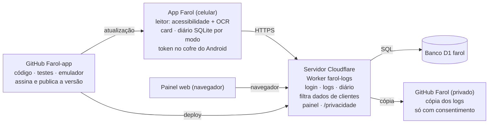

# Farol — Documento mestre do projeto

Atualizado em 14/11/2026 · versão **6.5.4** (versionCode 49)

> Este documento existe em três cópias, atualizadas juntas a cada versão: aqui (`docs/PROJETO.md`), no
> [documento do Claude](https://claude.ai/artifact/6CZzyRGabUH5TiHcsch2SE) e no [Notion](https://www.notion.so/41819e43f6b18192ab72e0f481010611).

## Visão geral

O Farol é um app Android pessoal que lê as ofertas dos apps de entrega e corrida e mostra na hora um card verde,
amarelo ou vermelho com o lucro real.

- **Para quem:** entregador de moto em São Paulo e São Caetano (Carlos) e motorista de carro que usa só a 99 (Marcelo).
- **Apps lidos:** Keeta, 99, iFood, Uber e inDrive.
- **Modos:** moto e carro, cada um com seus custos, faixas, diário e banco separados.
- **Além do card:** diário de turnos, ganhos por app e por entrega, gastos, metas de dia, semana e mês,
  abastecimentos, histórico de ofertas, painel web e atualização automática.
- **O que o Farol não faz:** não aceita corrida, não toca na tela dos apps e não interfere neles. Ele só lê e avisa.

| Peça | Onde |
| --- | --- |
| Código do app e do servidor | GitHub `carlospjjj-oss/Farol-app` (público) |
| Cópia dos logs | GitHub `carlospjjj-oss/Farol` (privado) |
| Servidor | Cloudflare Worker `farol-logs` |
| Banco | Cloudflare D1 `farol` |
| Painel web | `https://farol-logs.carlos-pjjj.workers.dev/painel` |
| Aviso de privacidade | `/privacidade` no mesmo endereço |

## Arquitetura

O celular fala só com o servidor, por HTTPS e com token. O servidor grava no D1 e copia os logs para o GitHub
privado só quando o usuário consentiu. O repositório público testa, assina e publica as versões, e o app se
atualiza sozinho.

- **App:** Kotlin, Android 8 a 15 (minSdk 26, targetSdk 35), telas montadas em código. Tarefas de fundo: logs e
  sincronização a cada 15 min, procura de atualização a cada 6 h.
- **Servidor:** `server/worker.js`; rotas `/v1/auth/*`, `/v1/logs`, `/v1/sync`, `/v1/me/*` (consentimento, exportar,
  excluir), `/v1/admin/*`, `/api/painel`, `/painel`, `/privacidade`.
- **Banco D1:** contas, sessões, eventos, dias do diário, abastecimentos, erros do app.

## Regras de negócio

A cor do card é sempre a pior entre R$/km, R$/h e nota; os alertas do usuário deixam o card vermelho. Ganho nunca é
contado duas vezes.

| Regra | Como funciona | Onde no código |
| --- | --- | --- |
| Custo por km | combustível ÷ km/l + outros custos por km. Cada modo guarda etanol e gasolina | `CostProfile`, `Settings` |
| Cor do card | pior entre R$/km, R$/h e nota, contra as faixas verde e amarelo | `ProfitCalculator` |
| Alertas | busca máxima, distância, tempo, valor mínimo, lucro mínimo e bairros deixam vermelho | `ProfitCalculator` |
| Explicação no card | uma frase + até 2 motivos (+/−), regras fixas no celular, sem IA | `OfferExplainer` |
| Espera do restaurante | média por restaurante (mínimo 3 coletas, só no celular). A partir de 8 min entra no tempo e derruba o R$/h | `WaitStats`, `DeliveryTracker` |
| Ganho do app no dia | o MAIOR entre: painel ou valor lançado, soma das entregas (`app#pedido`) e histórico (`app$saldo`, `app$lanc`). Nunca soma as fontes | `DayRecord.appEarnings` (app) e `appEarnings` (servidor) |
| Valor digitado à mão | vale mais que a soma automática daquele app | `editEarnings` |
| Dia do turno | turno que passa da meia-noite continua no dia em que começou, até encerrar ou por no máximo 20 h | `JournalStore.workDate` |
| Líquido | ganhos − custo do km − gastos lançados. Combustível não é gasto: já está no custo por km | `JournalMath`, `GoalMath.dayNet` |
| Metas | meta do dia em líquido. Semana = meta × dias de trabalho; mês proporcional. Folga não conta contra; o que falta é dividido pelos dias que restam | `GoalMath` |
| Folga | marcada só em dia sem turno nem ganho. Iniciar turno desmarca | `DayRecord.dayOff` |
| Pausa | notificação fixa enquanto pausado, lembrete se um app de corrida abrir, iniciar turno religa | `PauseControl` |

## Leitura dos apps

O Farol lê a tela por acessibilidade. Quando o app esconde o texto, como a 99, lê pela imagem (OCR com ML Kit). Cada
leitor foi montado com telas reais, e 102 ofertas reais anonimizadas ficam num teste que roda a cada versão.

| App | Oferta | Ganho por entrega | Histórico | Limites conhecidos |
| --- | --- | --- | --- | --- |
| Keeta | acessibilidade; restaurante da oferta em "Coleta \| nome" | "Pedido concluído! Seus ganhos R$ X #pedido" | Estatísticas › Diárias: total do dia escolhido | — |
| 99 | OCR; pares "N min (X km)" | no "Concluir" com #pedido, usa a última oferta lida | Saldo pela imagem: cada entrega e bônus, no turno da hora | dois pedidos juntos podem trocar os valores (total certo); dinheiro e negativos ficam de fora |
| iFood | acessibilidade | — | Financeiro › Lançamentos: data do cabeçalho + hora + valor | soma na tela de concluído ainda não existe |
| Uber | acessibilidade | — | "Ganhos de hoje" no painel | — |
| inDrive | acessibilidade; "pedido de viagem", "preço justo" | — | — | "~X km" é ignorado; busca é a distância colada a "N min" |

- **Etapas da entrega (Keeta):** coleta → chegada na loja → entrega → livre. Medem tempo até coletar, espera e tempo
  de entrega (`PhaseDetector`, `DeliveryTracker`).
- **Saúde do leitor:** conta ofertas lidas e perdidas por app e por dia. O painel avisa quando a taxa cai (`ReaderHealth`).
- **Telas registradas:** com o compartilhamento ligado, só até 90 min depois de uma oferta, mais as telas de
  histórico (sempre), para ajustar os leitores.
- **Configuração por marca:** caminhos de Samsung, Motorola e Xiaomi no guia do app (`DeviceGuide`) e em
  [`docs/celulares.md`](celulares.md).
- **Pendência:** reconhecer as etapas da corrida da 99 Motorista (carro) quando chegarem as telas do Marcelo.

## Segurança e privacidade

Nenhum segredo fica no celular nem no repositório público. Os textos das telas só saem do celular com o
consentimento do usuário, e dados de clientes nunca saem.

- **Login:** e-mail e senha. Senha com PBKDF2 (30 mil iterações); a sessão fica guardada como SHA-256 do token. No
  celular, o token fica no cofre do Android (Keystore AES-GCM). Há limite de tentativas.
- **Assinatura do app:** rotação de chave APK v3. A chave antiga assina v2 e a nova (`farol2`, RSA 4096) assina v3.
  As duas ficam só nos segredos do GitHub (`FAROL_OLD_*`, `FAROL_NEW_*`).
- **Atualizador:** confere SHA-256 do arquivo, pacote, versão maior e certificado da chave antes de instalar.
- **Servidor:** token da Cloudflare só no segredo `CLOUDFLARE_API_TOKEN` do GitHub. O deploy é automático a cada
  mudança em `server/worker.js`.
- **LGPD:** aviso de privacidade versão 2026-11-13, aceite obrigatório, compartilhamento de textos desligado por
  padrão, exportar e excluir dados no app. Documentos de DPO em [`docs/lgpd/`](lgpd/) (registro, RIPD, incidentes,
  atendimento).
- **Retenção:** textos apagados em 90 dias, telas em 1 ano, erros do app em 180 dias (rotina diária no servidor).
- **Dados de terceiros:** chat com cliente nunca sai do celular; nome do cliente vira "[cliente]" no app e de novo no
  servidor (protege versões antigas); endereço mascarado; nome de restaurante só no celular. Em 14/11 o que já estava
  guardado foi limpo e o histórico da cópia no GitHub foi reescrito.
- **Pendência:** trocar `CONTATO_PRIVACIDADE` (hoje um e-mail de teste) por um e-mail real antes de outras pessoas usarem.

## Fluxo de versão e testes

Nada chega ao celular sem passar por testes no computador e no emulador.

1. Desenvolver no ramo `fase1`.
2. Testes no computador: 132 testes de regras e leitores, incluindo 102 ofertas reais (`OfertasReaisTest`).
3. Push em `fase1` roda o build e o emulador Android (API 34): testes de banco, telas e prints. Os prints vão para o
   ramo `prints`.
4. Conferir os prints.
5. Juntar em `main` (fast-forward). O "Build APK" assina, publica a release com `versionCode`, `versionName` e
   `sha256`, e os celulares atualizam sozinhos em até 6 h.
6. Se `server/worker.js` mudou, o servidor é publicado na Cloudflare no mesmo push.
7. Atualizar o README (selo da versão e histórico) e as três cópias deste documento.

- **Consultas ao servidor:** o ramo `status` tem um workflow só de leitura que consulta o banco D1 (sem e-mails nem
  textos de clientes) para conferir versão, ajustes e dias de cada conta.
- **Testes do servidor:** scripts Node com SQLite simulando o D1 (login, sincronização, LGPD, retenção, semana,
  filtro de terceiros, regra de ganhos).

## Decisões e o porquê

| Decisão | Por quê |
| --- | --- |
| Ganho do app = maior fonte, nunca a soma | o painel do app já inclui as entregas; somar contaria duas vezes |
| Oferta não soma ganho | pode ser recusada; só conta na conclusão ou no histórico |
| 99 sem oferta lida não chuta valor | melhor faltar e completar pelo Saldo do que inventar |
| Saldo da 99 só entra se um turno cobrir a hora | a tela mostra só hora, sem data |
| Explicação do card sem IA | precisa ser instantânea, offline e sempre igual para o mesmo número |
| Turno pertence ao dia em que começou | o painel não pode zerar à meia-noite com turno aberto |
| Meta em líquido | ganhar muito rodando muito pode não sobrar nada |
| Combustível fora dos gastos | já entra no custo por km; seria contado duas vezes |
| Nome de restaurante só no celular | dado de terceiro, não precisa ir para o servidor |
| Filtro de clientes também no servidor | protege quem ainda está numa versão antiga do app |
| Uma versão por pacote de mudanças | pedido do Carlos para não soltar várias versões seguidas; correções urgentes saem como x.y.z |
| Banco SQLite por modo | moto e carro não se misturam |

## Estado atual e roteiro

A 6.5 fecha a parte de dinheiro (ganho automático, gastos, metas). A próxima frente é ajudar a decidir a corrida:
destino e chance de volta.

| Quando | O quê |
| --- | --- |
| Agora | validar a 6.5.4 rodando: explicação no card, soma das entregas, leitura do histórico, espera dos restaurantes |
| 6.6 | região do destino e chance de corrida de volta, calculado no celular com o histórico de ofertas |
| Com as telas do Marcelo | etapas e ganho da corrida da 99 Motorista (carro) |
| ~3 semanas de dados (início de dez/2026) | previsão de ganho por horário, faixas que se ajustam sozinhas, "Pergunte ao Farol" no painel |
| Menores | gastos e metas no painel web, tema claro no painel, soma do iFood na tela de concluído |

**Limites conhecidos**

- 99 com dois pedidos ao mesmo tempo: valores podem ser atribuídos trocados (o total fica certo).
- Leitura do Saldo da 99 pela imagem ainda não foi confirmada com o texto real do celular.
- Caminhos dos menus por marca podem variar entre modelos.

## Usuários e pendências

| Conta | Modo e apps | Situação em 14/11 |
| --- | --- | --- |
| Carlos | moto: Keeta, 99, iFood (e Uber, inDrive) | 6.5.x, compartilhamento desligado, dias 11 a 13 completos |
| Marcelo | carro: só 99 | ainda na 6.3.1; custos zerados (R$ 0,05/km), faixas baixas, km do turno de 13/11 errado; compartilhamento ligado |

- [ ] Marcelo: atualizar para a 6.5.4, corrigir custos e faixas, corrigir o km do turno de 13/11
- [ ] Trocar `CONTATO_PRIVACIDADE` por um e-mail real
- [x] Conectar o Notion e criar a cópia deste documento
- [ ] Conferir a leitura do Saldo da 99 pela imagem no próximo fechamento de dia
