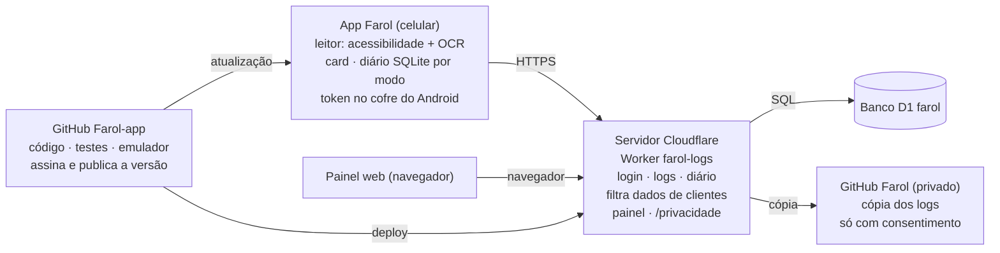

# Farol — Documento mestre do projeto

Atualizado em 16/11/2026 · versão **6.10.8** (versionCode 63)

> Este documento existe em três cópias, atualizadas juntas a cada versão: aqui (`docs/PROJETO.md`), no
> [documento do Claude](https://claude.ai/artifact/6CZzyRGabUH5TiHcsch2SE) e no [Notion](https://www.notion.so/41819e43f6b18192ab72e0f481010611).

## Visão geral

O Farol é um app Android pessoal que lê as ofertas dos apps de entrega e corrida e mostra na hora um card verde,
amarelo ou vermelho com o lucro real.

- **Para quem:** entregador de moto em São Paulo e São Caetano (Carlos) e motorista de carro que usa só a 99 (Marcelo).
- **Apps lidos:** Keeta, 99, iFood, Uber e inDrive.
- **Modos:** moto e carro, cada um com seus custos, faixas, diário e banco separados.
- **Além do card:** diário de turnos, ganhos por app e por entrega, gastos, metas de dia, semana e mês,
  abastecimentos, histórico de ofertas, painel web e atualização automática.
- **O que o Farol não faz:** não aceita corrida, não toca na tela dos apps e não interfere neles. Ele só lê e avisa.

| Peça | Onde |
| --- | --- |
| Código do app e do servidor | GitHub `carlospjjj-oss/Farol-app` (público) |
| Cópia dos logs | GitHub `carlospjjj-oss/Farol` (privado) |
| Servidor | Cloudflare Worker `farol-logs` |
| Banco | Cloudflare D1 `farol` |
| Painel web | `https://farol-logs.carlos-pjjj.workers.dev/painel` |
| Aviso de privacidade | `/privacidade` no mesmo endereço |

## Arquitetura

O celular fala só com o servidor, por HTTPS e com token. O servidor grava no D1 e copia os logs para o GitHub
privado só quando o usuário consentiu. O repositório público testa, assina e publica as versões, e o app se
atualiza sozinho.

- **App:** Kotlin, Android 8 a 15 (minSdk 26, targetSdk 35), telas montadas em código. Tarefas de fundo: logs e
  sincronização a cada 15 min (e o diário sobe logo depois de cada ganho lido, 6.10.8), procura de atualização a cada 6 h.
- **Servidor:** `server/worker.js`; rotas `/v1/auth/*`, `/v1/logs`, `/v1/sync`, `/v1/me/*` (consentimento, exportar,
  excluir, alertas), `/v1/admin/*` (inclui ligar o bot do Telegram), `/v1/telegram` (webhook do bot), `/api/painel`,
  `/painel`, `/privacidade`. De hora em hora (cron do Worker) roda a passada do bot do Telegram.
- **Painel do app em abas (6.9):** Início, Corridas, Financeiro, Análises e Mais, com barra fixa embaixo; a última aba
  aberta é lembrada (`DashboardTabs`).
- **Troca de conta no celular (6.10.3):** outra conta entrando apaga do aparelho o diário e a reserva de emergência
  do dono anterior (estão na conta dele); sair da conta sincroniza antes.
- **Banco D1:** contas, sessões, eventos, dias do diário, abastecimentos, erros do app.

## Regras de negócio

A cor do card é sempre a pior entre R$/km, R$/h e nota; os alertas do usuário deixam o card vermelho. Ganho nunca é
contado duas vezes.

| Regra | Como funciona | Onde no código |
| --- | --- | --- |
| Custo por km | combustível ÷ km/l + outros custos por km. Cada modo guarda etanol e gasolina | `CostProfile`, `Settings` |
| Cor do card | pior entre R$/km, R$/h e nota, contra as faixas verde e amarelo | `ProfitCalculator` |
| Alertas | busca máxima, distância, tempo, valor mínimo, lucro mínimo e bairros deixam vermelho | `ProfitCalculator` |
| Explicação no card | uma frase + até 2 motivos (+/−), regras fixas no celular, sem IA | `OfferExplainer` |
| Espera do restaurante | média por restaurante (mínimo 3 coletas, só no celular). A partir de 8 min entra no tempo e derruba o R$/h | `WaitStats`, `DeliveryTracker` |
| Ganho do app no dia | o MAIOR entre: painel ou valor lançado, soma das entregas (`app#pedido`) e histórico (`app$saldo`, `app$lanc`). Nunca soma as fontes | `DayRecord.appEarnings` (app) e `appEarnings` (servidor) |
| Valor digitado à mão | vale mais que a soma automática daquele app | `editEarnings` |
| Dia do turno | turno que passa da meia-noite continua no dia em que começou, até encerrar ou por no máximo 20 h | `JournalStore.workDate` |
| Líquido | ganhos − custo do km − gastos lançados. Combustível e manutenção não saem de novo: já estão no custo por km | `JournalMath`, `GoalMath.dayNet` |
| Metas | meta do dia em líquido (ou em bruto, se ligado em Ajustes › Metas). Semana = meta × dias de trabalho; mês proporcional. Folga não conta contra; o que falta é dividido pelos dias que restam | `GoalMath` |
| Folga | marcada só em dia sem turno nem ganho. Iniciar turno desmarca | `DayRecord.dayOff` |
| Pausa | notificação fixa enquanto pausado, lembrete se um app de corrida abrir, iniciar turno religa | `PauseControl` |
| Ajustes fora do normal | consumo, preço, custo por km e faixas fora das faixas típicas: salvar pede confirmação; o aviso aparece no app e no bot do Telegram do admin | `SettingsSanity` (app) e `settingsProblems` (servidor) |
| Destino e chance de volta | região de coleta e destino lida do endereço (Keeta, iFood, 99 corrida). Chance de volta = ofertas com coleta naquela região no mesmo horário (±1 h) nos últimos 30 dias: 6+ boa, 2–5 alguma, 0–1 pouca. Precisa de 30 ofertas com região; destino só com a cidade de casa não mostra nada. Só no celular | `RegionReader`, `ReturnChance` |
| Painel web: quem vê o quê | cada conta vê só os próprios números (ganhos, ofertas, diário), o administrador também. Das outras contas o admin vê só o técnico: versão, último sinal, leitura de hoje por app, avisos e travamentos (desde 16/11/2026) | `panelApi`, `/v1/admin/users` |
| Alertas das contas | desatualizado, pausado, ajustes fora do normal, turno aberto > 20 h, leitura caindo, sem sinal 3+ dias. No app: uma linha curta só com os avisos da própria conta (detalhe ao tocar). No painel web: não aparecem (o admin recebe no bot do Telegram, desde 16/11/2026) | `accountAlerts`, `/v1/me/alertas`, `AlertsClient`, `DashboardAlerts` |
| Manutenção e caixinha | itens com intervalo em km (sugestões para conferir no manual) e km da última troca; aviso amarelo faltando 10% ou 300 km, vermelho quando passa. Caixinha = km rodados × "outros custos"/km − gastos de manutenção | `Maintenance`, `MaintenanceStore`, `DashboardCare` |
| Consumo real | de tanque cheio a tanque cheio, separado por combustível (abastecimentos antigos: etanol se até R\$ 4,80/L); trecho com tanque misturado não conta | `JournalMath.fuelStats` |
| Indicadores | ticket médio, entregas/hora (dias com entregas lidas), R\$/hora; por app; por faixa (almoço 11–15, tarde 15–18, jantar 18–23) só com 10+ entregas | `Indicators` |
| Caixinhas | manutenção (km × outros custos − trocas), combustível (km × combustível/km − abastecimentos) e emergência (valores guardados à mão), cada uma com meta opcional | `Boxes`, `BoxesStore` |
| Regiões de coleta | por região: ofertas, R\$/km médio, % verdes e melhor janela de 3 h; mínimo 5 ofertas; 30 dias; só no celular | `RegionStats` |
| Corrida à mão | chave `app#m…` com hora; soma na família das entregas do app (nunca com o painel); pode ser apagada | `askManualRide` |
| Bot do Telegram (administração) | só problemas do app: `/avisos`, `/contas` (versão, último sinal, leitura), `/erros` (travamentos); aviso na hora de problema novo, de resolvido e de travamento novo; resumo às 8h. Nunca ganhos, telas ou clientes. Vínculo por código de 6 dígitos gerado no painel | `telegramWebhook`, `telegramTick`, `TELEGRAM_TOKEN` |

## Leitura dos apps

O Farol lê a tela por acessibilidade. Quando o app esconde o texto, como a 99, lê pela imagem (OCR com ML Kit). Cada
leitor foi montado com telas reais, e 102 ofertas reais anonimizadas ficam num teste que roda a cada versão.

| App | Oferta | Ganho por entrega | Histórico | Limites conhecidos |
| --- | --- | --- | --- | --- |
| Keeta | acessibilidade; restaurante da oferta em "Coleta \| nome" | "Pedido concluído! Seus ganhos R$ X #pedido" | Estatísticas › Diárias: total do dia escolhido | — |
| 99 | OCR; pares "N min (X km)" | no "Concluir" com #pedido, usa a última oferta lida antes de o número do pedido aparecer na tela (oferta recusada durante a entrega não conta) | Saldo pela imagem: cada entrega e bônus, no turno da hora; Histórico de corridas pela imagem: cada entrega e bônus com data e hora (família "99$hist", 6.10.6; lista cortada na borda, 6.10.7); "ganhos de hoje" no painel antigo ("Painel \| R$") e na tela inicial nova ("R$ X \| 99 Abastece", 6.10.4; lida pela imagem a cada 30 s no máximo, 6.10.5) | dois pedidos juntos podem trocar os valores (total certo); dinheiro e negativos ficam de fora; entrega da 99 Food sem #pedido só entra pelo "ganhos de hoje"; a lista "Solicitações de Pedidos" não gera card |
| iFood | acessibilidade | — | Financeiro › Lançamentos: data do cabeçalho + hora + valor | soma na tela de concluído ainda não existe |
| Uber | acessibilidade | — | "Ganhos de hoje" no painel | — |
| inDrive | acessibilidade; "pedido de viagem", "preço justo" | — | — | "~X km" é ignorado; busca é a distância colada a "N min" |

- **Etapas da entrega (Keeta):** coleta → chegada na loja → entrega → livre. Medem tempo até coletar, espera e tempo
  de entrega (`PhaseDetector`, `DeliveryTracker`).
- **Saúde do leitor:** conta ofertas lidas e perdidas por app e por dia. O painel avisa quando a taxa cai (`ReaderHealth`).
- **Telas registradas:** com o compartilhamento ligado, só até 90 min depois de uma oferta, mais as telas de
  histórico (sempre), para ajustar os leitores.
- **Configuração por marca:** caminhos de Samsung, Motorola e Xiaomi no guia do app (`DeviceGuide`) e em
  [`docs/celulares.md`](celulares.md).
- **Pendência:** reconhecer as etapas da corrida da 99 Motorista (carro) quando chegarem as telas do Marcelo.

## Segurança e privacidade

Nenhum segredo fica no celular nem no repositório público. Os textos das telas só saem do celular com o
consentimento do usuário, e dados de clientes nunca saem.

- **Login:** e-mail e senha. Senha com PBKDF2 (30 mil iterações); a sessão fica guardada como SHA-256 do token. No
  celular, o token fica no cofre do Android (Keystore AES-GCM). Há limite de tentativas.
- **Assinatura do app:** rotação de chave APK v3. A chave antiga assina v2 e a nova (`farol2`, RSA 4096) assina v3.
  As duas ficam só nos segredos do GitHub (`FAROL_OLD_*`, `FAROL_NEW_*`).
- **Administrador:** o cadastro comum nunca cria admin (nem a primeira conta). O primeiro admin é ativado com o
  segredo `ADMIN_SETUP_KEY` (Cloudflare) em `/v1/auth/ativar-admin`, que só funciona enquanto não existe admin (desde 16/11/2026).
- **Envios só com login (16/11/2026):** o servidor recusa envio sem conta (a transição acabou; havia 0 envios sem conta) e o login
  não reivindica mais dados antigos pelo id do celular. Limite de envios por celular e por conta. Hora dos eventos validada.
- **Páginas do painel e da privacidade:** não abrem dentro de outro site (`X-Frame-Options`, `frame-ancestors`), `nosniff`, sem referer.
- **Bot do Telegram:** token só no segredo `TELEGRAM_TOKEN` da Cloudflare; o segredo do webhook é gerado pelo servidor e
  fica no banco; só chats vinculados com o código do painel recebem algo.
- **Atualizador:** confere SHA-256 do arquivo, pacote, versão maior e certificado da chave antes de instalar.
- **Servidor:** token da Cloudflare só no segredo `CLOUDFLARE_API_TOKEN` do GitHub. O deploy é automático a cada
  mudança em `server/worker.js`.
- **LGPD:** aviso de privacidade versão 2026-11-14 (Telegram entrou como operador; pede novo aceite), aceite obrigatório, compartilhamento de textos desligado por
  padrão, exportar e excluir dados no app. Documentos de DPO em [`docs/lgpd/`](lgpd/) (registro, RIPD, incidentes,
  atendimento).
- **Retenção:** textos apagados em 90 dias, telas em 1 ano, erros do app em 180 dias (rotina diária no servidor).
- **Dados de terceiros:** chat com cliente nunca sai do celular; nome do cliente vira "[cliente]" no app e de novo no Em 16/11 (6.10.7): endereço lido pela imagem com o ícone do mapa colado ("O Rua…", "OR.…"), CEP com "O" ou cortado e o nome e o código de verificação do cliente na "Retirada concluída" da 99 passaram a ser mascarados no celular e no servidor; o que tinha sido guardado foi limpo (banco e cópia no GitHub, com o histórico reescrito).
  servidor (protege versões antigas); endereço mascarado; nome de restaurante só no celular. Em 14/11 o que já estava
  guardado foi limpo e o histórico da cópia no GitHub foi reescrito.
- **Pendência:** trocar `CONTATO_PRIVACIDADE` (hoje um e-mail de teste) por um e-mail real antes de outras pessoas usarem.

## Fluxo de versão e testes

Nada chega ao celular sem passar por testes no computador e no emulador.

1. Desenvolver no ramo `fase1`.
2. Testes no computador: 162 testes de regras e leitores, incluindo 102 ofertas reais (`OfertasReaisTest`), o banco de telas reais (`golden/telas_reais.tsv`, `TelasReaisTest`) e o dia inteiro de ganhos (`EarningsRecorderTest`).
3. Push em `fase1` roda o build e o emulador Android (API 34): testes de banco, telas e prints. Os prints vão para o
   ramo `prints`.
4. Conferir os prints.
5. Juntar em `main` (fast-forward). O "Build APK" assina e publica a release como **prévia** (`versionCode`,
   `versionName`, `sha256`). Quem está no **canal de teste** (padrão do admin) recebe na hora; o workflow
   "Promover versão" a torna estável para todos depois de 24 h (ou na hora, rodando com `promover_agora=sim`).
6. Se `server/worker.js` mudou, o servidor é publicado na Cloudflare no mesmo push. O build do app só cria release quando o
   `versionCode` é novo (push sem mudar a versão não repete a release).
7. Atualizar o README (selo da versão e histórico) e as três cópias deste documento.

- **Consultas ao servidor:** o ramo `status` tem um workflow só de leitura que consulta o banco D1 (sem e-mails nem
  textos de clientes) para conferir versão, ajustes e dias de cada conta.
- **Telas reais novas:** `python3 tools/telas_golden.py <logs>` lista telas de ganho, histórico e espera que ainda
  não estão no banco; conferir, preencher o esperado e colar em `telas_reais.tsv`.
- **Testes do servidor:** scripts Node com SQLite simulando o D1 (login, sincronização, LGPD, retenção, semana,
  filtro de terceiros, regra de ganhos).

- **Testes do servidor:** `server/test/`, rodam no GitHub a cada mudança e antes de publicar o servidor (desde 16/11/2026).

## Decisões e o porquê

| Decisão | Por quê |
| --- | --- |
| Ganho do app = maior fonte, nunca a soma | o painel do app já inclui as entregas; somar contaria duas vezes |
| Oferta não soma ganho | pode ser recusada; só conta na conclusão ou no histórico |
| 99 sem oferta lida não chuta valor | melhor faltar e completar pelo Saldo do que inventar |
| Saldo da 99 só entra se um turno cobrir a hora | a tela mostra só hora, sem data |
| Explicação do card sem IA | precisa ser instantânea, offline e sempre igual para o mesmo número |
| Turno pertence ao dia em que começou | o painel não pode zerar à meia-noite com turno aberto |
| Meta em líquido | ganhar muito rodando muito pode não sobrar nada |
| Combustível fora dos gastos | já entra no custo por km; seria contado duas vezes |
| Manutenção sai da caixinha, não do líquido | os "outros custos"/km já reservam esse dinheiro todo dia; descontar a troca de novo contaria duas vezes |
| Consumo real separado por combustível | misturar gasolina e etanol dá um número que não é de nenhum dos dois |
| Nome de restaurante só no celular | dado de terceiro, não precisa ir para o servidor |
| Filtro de clientes também no servidor | protege quem ainda está numa versão antiga do app |
| Uma versão por pacote de mudanças | pedido do Carlos para não soltar várias versões seguidas; correções urgentes saem como x.y.z |
| Banco SQLite por modo | moto e carro não se misturam |

## Estado atual e roteiro

> **Congelamento até dezembro/2026:** só correção de bugs, nada de função nova (decisão de 14/11/2026). O
> [roadmap e análise a fundo](https://claude.ai/artifact/TNNmE3furDGK1t5AbZFCT2) fica como mapeamento e será revisto em dezembro.

A 6.5 fechou a parte de dinheiro, a 6.6 a confiabilidade (Fase 3) e o destino com chance de volta, a 6.7 levou os
avisos das outras contas para um bot do Telegram da administração, a 6.8 trouxe o manual de gestão
(manutenção, caixinha, consumo real e indicadores), a 6.9 dividiu o painel em abas e a 6.10
trouxe caixinhas, gráficos, regiões e corrida à mão. O que falta depende
de rodar: validar na rua, telas do carro do Marcelo e 3 semanas de dados para a previsão.

| Quando | O quê |
| --- | --- |
| Agora (até dezembro) | congelamento: só correções. Validar a 6.6 a 6.10.8 na rua. Auditoria técnica de 16/11: 7 de 8 módulos feitos (backend 12 correções, cálculo 6.10.2, sincronização 6.10.3, Android sem defeitos, painel, testes e publicação); falta a leitura OCR: em 16/11 a 99 mudou a tela inicial (corrigido de 6.10.4 a 6.10.6) e passou a mostrar ofertas na lista "Solicitações de Pedidos", que ainda não gera card (espera o texto/print da lista) |
| Fase 3 (confiabilidade) | concluída: alertas e checagem dos ajustes (6.5.5); leitor de ganhos separado e testado, banco de telas reais, canal de teste (6.6) |
| Com as telas do Marcelo | etapas e ganho da corrida da 99 Motorista (carro) |
| ~3 semanas de dados (início de dez/2026) | previsão de ganho por horário, faixas que se ajustam sozinhas, "Pergunte ao Farol" no painel |
| Menores | gastos e metas no painel web, tema claro no painel, soma do iFood na tela de concluído |

**Limites conhecidos**

- 99 com dois pedidos ao mesmo tempo: valores podem ser atribuídos trocados (o total fica certo).
- O print do OCR pega a tela inteira: janela de oferta de outro app por cima da 99 é ignorada quando outro app leu a mesma oferta nos últimos 15 s (6.10.6).
- 99 avisou "Conta pausada por excesso de rejeições" em 16/11 (15h37): nesse estado a tela inicial não mostra o "ganhos de hoje"; o Histórico de corridas cobre.
- Pedido adicional da 99 (23h48 de 13/11) não gerou card: tela diferente, falta o print para ajustar o leitor (o Saldo registrou a entrega).
- Caminhos dos menus por marca podem variar entre modelos.
- Chance de volta só usa a região de COLETA das ofertas recebidas; o iFood esconde o bairro da loja em parte das
  ofertas e a 99 Entrega (imagem) não tem região. Destino só com a cidade (Keeta) dá resposta só por cidade.

## Usuários e pendências

| Conta | Modo e apps | Situação em 16/11 |
| --- | --- | --- |
| Carlos | moto: Keeta, 99, iFood (e Uber, inDrive) | canal de teste (recebe primeiro), admin, bot do Telegram ligado, compartilhamento ligado |
| Marcelo | carro: só 99 | ainda na 6.3.1 (o bot avisa); custos zerados (R$ 0,05/km), faixas baixas, km do turno de 13/11 errado; compartilhamento ligado |

- [x] Bot do Telegram criado, token renovado e vinculado (16/11)
- [ ] Marcelo: atualizar para a 6.10.8 (vai pedir novo aceite do aviso de privacidade), corrigir custos e faixas (e a nota mínima/verde), corrigir o km do turno de 13/11
- [ ] Trocar `CONTATO_PRIVACIDADE` por um e-mail real
- [x] Conectar o Notion e criar a cópia deste documento
- [x] Leitura do Saldo da 99 pela imagem confirmada (13/11: entregas das 23h48 e 23h57 e bônus)
- [ ] Abrir a lista "Solicitações de Pedidos" da 99 por uns 20 s ou mandar print (auditoria da leitura OCR)
- [ ] Opcional: apagar a release duplicada "Farol 6.10.3" (v1.108) no GitHub
